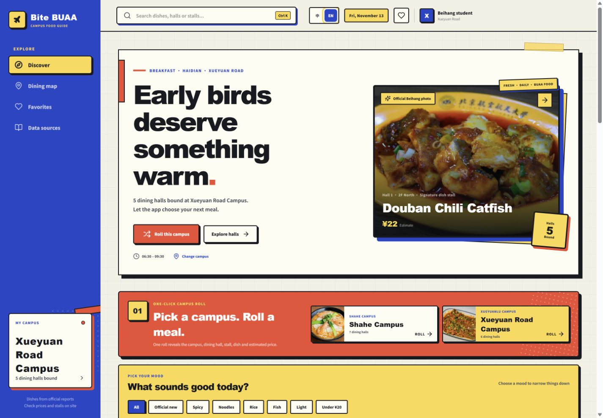
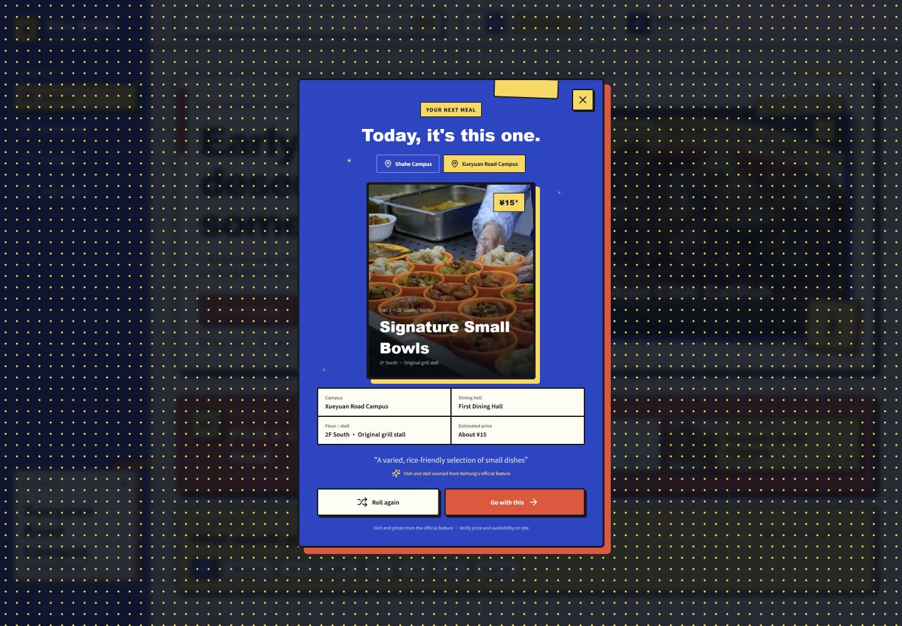
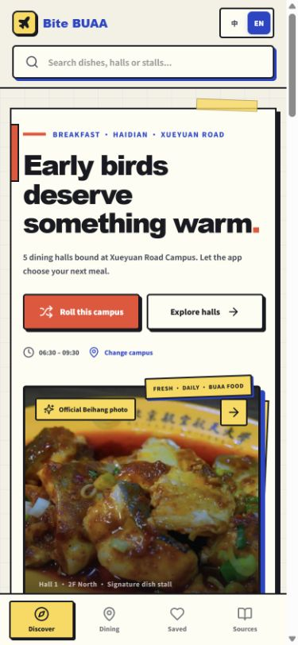

# Bite BUAA

**A bilingual campus dining discovery app for Beihang University students.**

[简体中文](README.zh-CN.md) · English


Bite BUAA turns the daily question — *“What should I eat today?”* — into a fast, visual decision. Students can bind their campus and favorite dining halls, explore real dishes from Beihang University, or let **Roll** choose a complete meal including the campus, dining hall, floor, stall, dish, and estimated price.

<p align="center">
  
</p>

## Why this project

University dining information is scattered across notices, public-account posts, menus, and word of mouth. Bite BUAA brings it into one focused experience designed around the decision students actually make every day.

- **Campus-first discovery:** bind Shahe or Xueyuan Road and choose the halls you use.
- **One-click campus Roll:** choose a campus and receive the hall, stall, dish, and estimated price at once.
- **Verified visual menu:** 39 dishes with matching photos from Beihang University's official spring 2026 menu feature.
- **Bilingual by design:** switch between Chinese and English instantly; the choice is saved locally.
- **Decision filters:** filter by mood, spice, noodles, rice, fish, lighter meals, and price.
- **Useful details:** floor, stall name, serving time, official tasting note, source status, and data provenance.
- **Favorites:** keep a persistent personal food list in the browser.
- **Responsive:** designed for desktop and mobile.

## Screenshots

### Complete Roll result

The result always contains the campus, dining hall, floor/stall, dish, and estimated price.

<p align="center">
  
</p>

### Mobile experience

<p align="center">
  
</p>

## Quick start

Requirements: Node.js 20+ and npm.

```bash
npm install
npm run dev
```

Open [http://localhost:5173](http://localhost:5173).

Production build:

```bash
npm run build
npm run preview
```

## How Roll works

1. Open the homepage.
2. Choose **Shahe Campus** or **Xueyuan Road Campus** in the one-click Roll panel.
3. The app draws a dish from every dining hall available on that campus.
4. The result displays:
   - campus
   - dining hall
   - floor and stall
   - dish name and official photo
   - estimated price
   - the official tasting note
5. Roll again or open the full dish detail.

The language toggle is available in the top bar and persists across reloads.

## Data provenance

Dish names, stall locations, official tasting notes, and photos are sourced from the Beihang University official WeChat article:

> **《谁不爱北航的新菜品呢？》**  
> Beijing University of Aeronautics and Astronautics  
> Spring 2026 campus menu feature

Campus floors and selected opening hours reference public Beihang orientation guides. Exact image URLs and the public search entry are documented in:

- [`public/images/ATTRIBUTION.md`](public/images/ATTRIBUTION.md)
- [`public/images/buaa/source-meta.json`](public/images/buaa/source-meta.json)

### Important limitations

- Prices shown in the app are **indicative estimates**, not an official live price list.
- A dish appearing in the spring menu feature does not guarantee same-day availability.
- Stalls and opening hours may change by semester or temporary notice.
- This project is not connected to a live Beihang dining system.

## Project structure

```text
.
├── docs/screenshots/          # English README screenshots
├── public/images/buaa/        # Local dish images and source metadata
├── src/
│   ├── App.jsx                # Application state and interface
│   ├── data.js                # Campuses, dining halls, dishes and sources
│   ├── i18n.js                # English localization helpers
│   ├── main.jsx               # React entry point
│   └── styles.css             # Responsive visual system
├── index.html
├── vite.config.js
└── package.json
```

## Updating the menu

Edit [`src/data.js`](src/data.js). Each dish uses fields such as:

```js
officialDish({
  id: "shahe-west1-mushroom-beef",
  canteenId: "shahe-west-1",
  name: "蒜香口蘑牛肉",
  window: "智慧自选餐线",
  price: 22,
  image: "shahe-west1-mushroom-beef",
  tags: ["官方上新", "高蛋白", "蒜香"],
  review: "蒜香滑嫩，口蘑鲜香",
})
```

When adding a new dish:

1. Add the image to `public/images/buaa/`.
2. Add a `dishEnglish` entry in `src/i18n.js`.
3. Add source metadata if the photo comes from a new article.
4. Run `npm run build`.

For production use, replace estimated prices with a structured live data source containing `price`, `priceUpdatedAt`, `priceSource`, `available`, and `stall`.

## Contributing

Issues and pull requests are welcome. Please keep visual data traceable to a public source and clearly distinguish official information from estimates.

## License

The source code is released under the [MIT License](LICENSE).

The Beihang University menu photos and reproduced factual menu information remain the property of their respective rights holders and are not relicensed by the MIT License.
