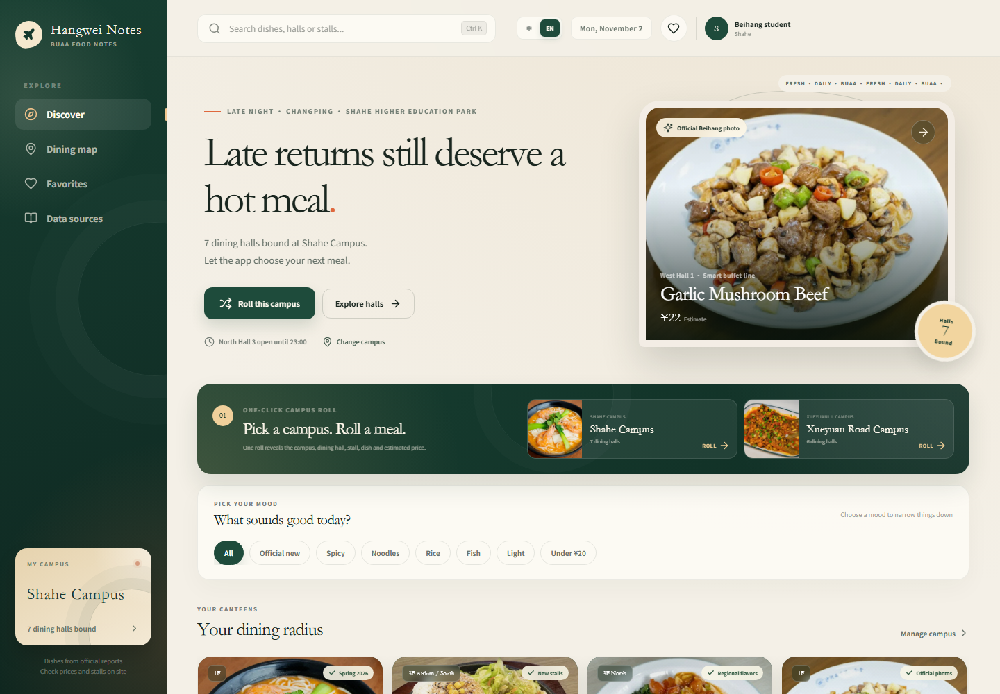
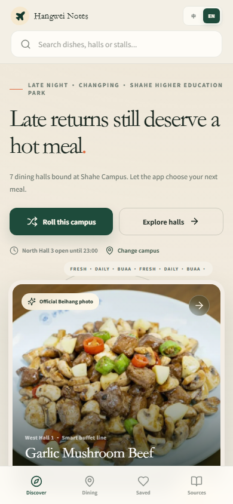

# 航味拾光

**面向北航学生的中英双语校园餐饮探索应用。**

简体中文 · [English](README.md)


航味拾光把“今天吃什么”变成一个快速、直观的决定。你可以绑定沙河或学院路校区、选择常去的食堂、浏览真实菜品，也可以通过 **Roll** 一次抽出校区、食堂、楼层窗口、菜品和参考价格。

<p align="center">
  
</p>

## 功能

- 沙河、学院路两校区绑定
- 自选常去食堂
- 沙河 / 学院路一键 Roll
- 结果显示完整食堂、窗口、菜品和价格信息
- 39 道北航官方 2026 春季上新菜品与对应实拍
- 中英文一键切换并保存在本机
- 口味、品类、鱼类、清淡与价格筛选
- 菜品详情、官方食评、窗口与来源说明
- 收藏与本地持久化
- 桌面端和移动端响应式界面

## 截图

### 完整 Roll 结果

<p align="center">
  
</p>

### 移动端

<p align="center">
  
</p>

## 本地运行

需要 Node.js 20+ 和 npm。

```bash
npm install
npm run dev
```

访问 [http://localhost:5173](http://localhost:5173)。

生产构建：

```bash
npm run build
npm run preview
```

## 数据来源

菜品名称、窗口位置、官方食评和照片来自北京航空航天大学官方微信公众号文章：

> **《谁不爱北航的新菜品呢？》**  
> 北京航空航天大学  
> 2026 年春季校园食堂上新

食堂楼层和部分营业时间参考北航公开迎新指南。图片来源、公开检索入口和原文图片 URL 见：

- [`public/images/ATTRIBUTION.md`](public/images/ATTRIBUTION.md)
- [`public/images/buaa/source-meta.json`](public/images/buaa/source-meta.json)

## 数据边界

- 项目中的价格是体验参考值，不是官方实时价目表。
- 官方上新报道中的菜品不保证每天供应。
- 窗口与营业时间可能随学期或临时通知调整。
- 项目没有接入北航实时餐饮系统。

## 项目结构

```text
.
├── docs/screenshots/          # 英文 README 截图
├── public/images/buaa/        # 本地菜品图片与来源元数据
├── src/
│   ├── App.jsx                # 应用状态与界面
│   ├── data.js                # 校区、食堂、菜品与来源
│   ├── i18n.js                # 英文交互与数据翻译
│   ├── main.jsx               # React 入口
│   └── styles.css             # 响应式视觉样式
├── index.html
├── vite.config.js
└── package.json
```

## 更新菜单

菜单与食堂数据集中在 [`src/data.js`](src/data.js)。新增菜品时：

1. 将图片放入 `public/images/buaa/`。
2. 在 `src/i18n.js` 中补充 `dishEnglish`。
3. 若照片来自新文章，补充来源元数据。
4. 执行 `npm run build`。

接入生产数据时，建议把参考价格替换成包含 `price`、`priceUpdatedAt`、`priceSource`、`available` 和 `stall` 的实时数据结构。

## 许可

源代码采用 [MIT License](LICENSE)。

北航公众号菜品照片及转载的菜单事实信息仍归原权利人所有，不包含在 MIT 授权范围内。
